# 🤖 Build Your First AI Agent from Scratch

### LangChain + LangGraph + Ollama Cloud — a complete beginner tutorial

> **No prior AI knowledge needed.** If you can run a Python file, you can finish this tutorial.
> By the end you will have built a **real AI agent** that can **read and write files on your computer** just by you chatting with it.

---

## 📚 Table of Contents

1. [What You Will Build](#-1-what-you-will-build)
2. [Prerequisites](#-2-prerequisites)
3. [PART A — The Concepts (read this first!)](#-part-a--the-concepts)
   - [3.1 What is an LLM?](#31-what-is-an-llm)
   - [3.2 What is an API, an API key and a base URL?](#32-what-is-an-api-an-api-key-and-a-base-url)
   - [3.3 What is Ollama?](#33-what-is-ollama)
   - [3.4 The problem: LLMs can only talk](#34-the-problem-llms-can-only-talk)
   - [3.5 What is a Tool?](#35-what-is-a-tool)
   - [3.6 What is an AI Agent?](#36-what-is-an-ai-agent)
   - [3.7 What is LangChain?](#37-what-is-langchain)
   - [3.8 What is LangGraph and why do we need it?](#38-what-is-langgraph-and-why-do-we-need-it)
   - [3.9 Graph vocabulary: State, Node, Edge](#39-graph-vocabulary-state-node-edge)
   - [3.10 Message types](#310-message-types)
4. [PART B — Setup](#%EF%B8%8F-part-b--setup-your-computer)
5. [PART C — Build the Agent Step by Step](#-part-c--build-the-agent-step-by-step)
6. [PART D — The Complete Code](#-part-d--the-complete-code)
7. [PART E — Run It!](#-part-e--run-it)
8. [PART F — How One Question Flows Through the Agent](#-part-f--how-one-question-flows-through-the-agent)
9. [Troubleshooting](#-troubleshooting)
10. [Safety Warning](#%EF%B8%8F-safety-warning)
11. [Glossary (Cheat Sheet)](#-glossary-cheat-sheet)

---

## 🎯 1. What You Will Build

A **terminal chatbot** that does not only *talk* — it can also **act**.

You type things like:

```text
> create a file called hello.txt that says "Hello from my first agent!"
> read hello.txt and tell me what is inside
> write a short poem about coffee into poem.txt
```

…and the AI decides **by itself** when to open a file or write a file, does it, and then tells you what it did.

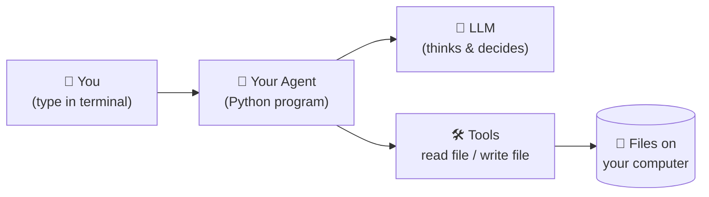

The whole program is **about 80 lines of Python**. Small, but it contains the *exact same pattern* used by big agents such as coding assistants.

---

## ✅ 2. Prerequisites

| You need | Why | How to check |
|---|---|---|
| **Python 3.10 or newer** | The language we write in | `python --version` (or `python3 --version`) |
| **pip** | Installs Python libraries | `pip --version` |
| **A code editor** (VS Code is great) | To write the code | — |
| **An Ollama API key** | Lets your program talk to a cloud LLM | Create one in your Ollama account (see [Part B](#-part-b--setup-your-computer)) |
| **A terminal** | To run commands | Terminal (Mac/Linux), PowerShell or CMD (Windows) |

You do **not** need a GPU, and you do **not** need to know any AI math.

---

# 🧠 PART A — The Concepts

> Take your time here. If you understand these 10 ideas, the code will feel obvious.

---

## 3.1 What is an LLM?

**LLM = Large Language Model.**

Think of it as a *super-powered autocomplete*. You give it text, and it predicts a very good continuation of that text. ChatGPT, Claude, Gemini, Llama, Gemma… are all LLMs.

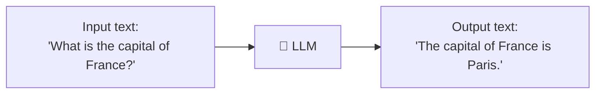

**Important facts for a beginner:**

- An LLM **only takes in text and gives out text.**
- It has **no hands**. It cannot open a file, browse a website, or run code by itself.
- It **does not remember** past conversations. Every time you call it, you must send the *whole* conversation again.

---

## 3.2 What is an API, an API key and a base URL?

Your computer is not powerful enough to run the biggest LLMs, so they run on **someone else's server** (in the cloud). Your program talks to that server over the internet.

| Term | Simple meaning | Real-life analogy |
|---|---|---|
| **API** | A set of rules for one program to talk to another program | A restaurant **menu + waiter**: you order in a fixed format, the kitchen (server) replies |
| **API key** | A secret password that proves *you* are allowed to use the server (and who to bill) | Your **membership card** |
| **Base URL** | The internet address of the server | The **restaurant's street address** |
| **Model name** | Which specific LLM you want to talk to | The **dish** you order |

In our project these three values live in a file called `.env`:

```env
OLLAMA_API_KEY=your_api_key          # your api here
OLLAMA_MODEL=gemma4:31b              # which model/dish
OLLAMA_API_URL=https://ollama.com/v1 # address of the server
```

---

## 3.3 What is Ollama?

**Ollama** is a tool/service for running LLMs.

- You can run models **locally** on your own PC (needs a decent computer).
- Or you can use **Ollama Cloud**, where they run the model for you on their servers. You just send requests with an API key. ← *This is what we do.*

Ollama exposes an **OpenAI-compatible API**. That means it "speaks the same language" as OpenAI's API. This is a *huge* convenience: any library that can talk to OpenAI (like `langchain_openai`) can also talk to Ollama just by changing the **base URL**. That is exactly why our code imports `ChatOpenAI` but connects to `https://ollama.com/v1`.

> 💡 **Model tip:** For this tutorial your model **must support "tool calling"** (explained below). On the Ollama website, models that support it have a **tools** tag. If you get an error saying the model doesn't support tools, pick a different model.

---

## 3.4 The problem: LLMs can only talk

Imagine you tell a plain LLM:

> "Create a file called `hello.txt` on my computer."

It can only reply with text like *"Sure! Here's how you could create the file…"*. It **cannot actually do it** — it has no hands.

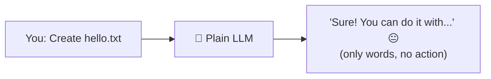

We need a way to give the LLM **hands**. Those hands are called **tools**.

---

## 3.5 What is a Tool?

A **tool** is simply **a normal Python function** that we *let the LLM ask us to run*.

Examples:
- `read_file(path)` → opens a file and returns its text
- `write_file(path, content)` → saves text into a file
- `search_web(query)` → searches the internet
- `get_weather(city)` → returns the weather

### How does the LLM "use" a tool?

The LLM **never runs the function itself.** Instead:

1. We tell the LLM: *"Here are the tools you may ask for, with their names and descriptions."*
2. The LLM replies with a **request**, like: *"Please run `write_file` with `file_path='hello.txt'` and `content='Hi'`."*
3. **Our Python program** sees that request and runs the real function.
4. We send the result back to the LLM.
5. The LLM reads the result and writes a final answer.

This request-from-the-LLM is called **tool calling** (or *function calling*).

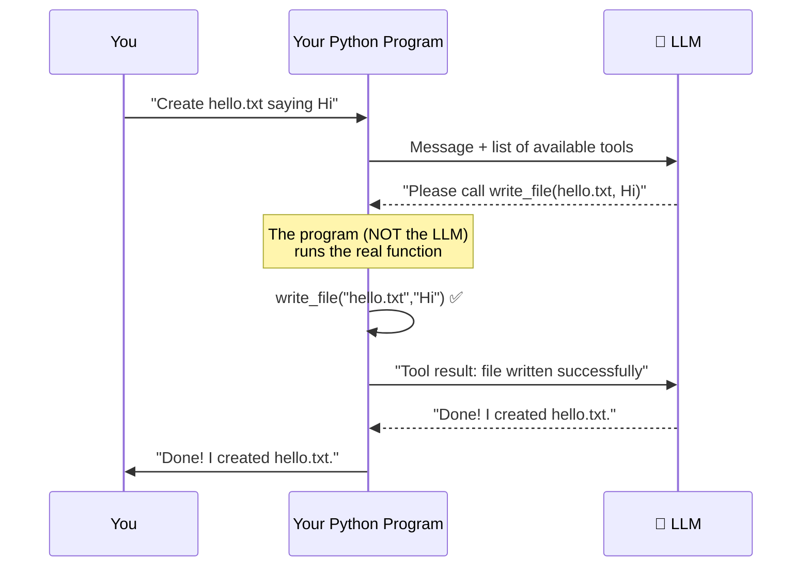

> 🔑 **Key insight:** The LLM is the **brain**, the tools are the **hands**, and your Python program is the **body** that connects them.

---

## 3.6 What is an AI Agent?

An **AI agent** is an LLM + tools + a **loop**.

A normal chatbot: *question → answer → done.*
An agent: *question → think → use a tool → look at the result → think again → maybe use another tool → … → final answer.*

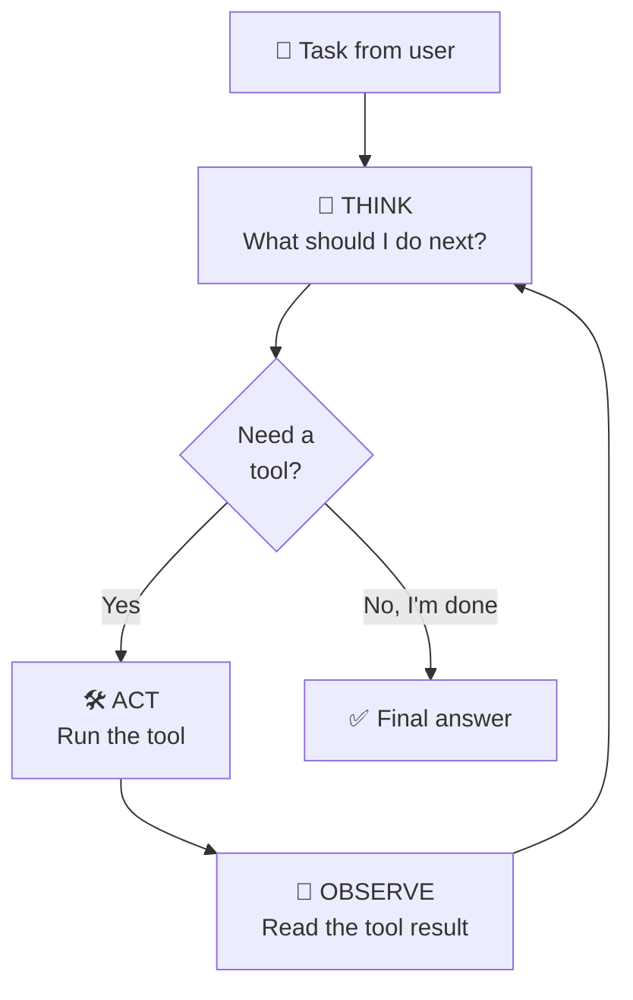

The loop **Think → Act → Observe → Think…** is the heart of every agent. Remember it; our code is literally this diagram.

Why is the loop important? Look at this request:

> "Read `notes.txt` and write a summarized version to `summary.txt`."

That needs **2 tool calls in order**: first read, *then* write (using what it read). The agent loops until the whole job is done.

---

## 3.7 What is LangChain?

**LangChain** is a Python library (a toolbox) that makes working with LLMs **easier**.

Without LangChain you would have to manually write HTTP requests, build JSON by hand, and parse the replies. LangChain wraps all that into neat building blocks:

| LangChain piece | What it gives you | Used in our code as |
|---|---|---|
| **Chat models** | A uniform way to talk to *any* LLM provider | `ChatOpenAI(...)` |
| **Messages** | Standard message objects | `HumanMessage` |
| **Tools** | Turn a Python function into an LLM-readable tool | `@tool` |
| **Prompt / chain helpers** | Many more (not needed today) | — |

Think of LangChain as **LEGO bricks** for LLM apps: each brick (model, message, tool) is ready-made.

> We install it as separate small packages: `langchain-core` (basics: messages, tools) and `langchain-openai` (the OpenAI-compatible model connector).

---

## 3.8 What is LangGraph and why do we need it?

**LangChain gives you the bricks. LangGraph gives you the blueprint for how the bricks connect — including loops.**

### The problem LangGraph solves

A simple LangChain "chain" runs in a **straight line**:

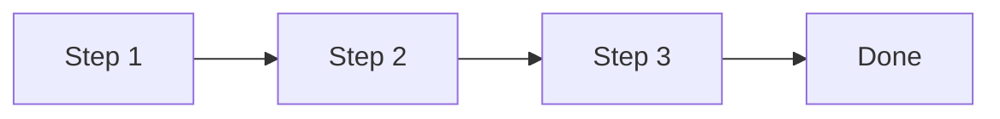

But an agent needs to **loop** and **make decisions** ("do I need a tool or am I finished?"). Straight lines can't do that. You *could* write a giant `while` loop with lots of `if` statements yourself… but it quickly becomes messy, hard to debug, and hard to extend.

**LangGraph** lets you describe your agent as a **graph** (a map of boxes and arrows):

- **Boxes** = things to do (ask the LLM, run a tool)
- **Arrows** = what happens next
- **Fork arrows** = decisions
- **Loops are allowed** ✅

Here is the exact graph we are going to build:

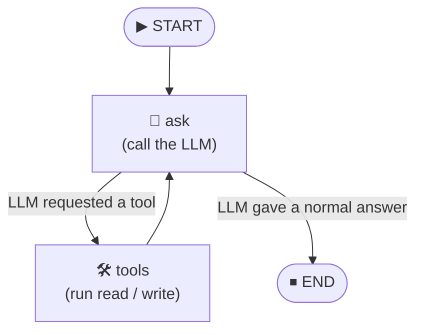

Notice the loop: `ask → tools → ask → tools → … → END`. That's our Think → Act → Observe cycle.

### Why LangGraph is great for learning agents

- ✅ You can **see** your agent as a diagram.
- ✅ Loops and decisions are **built in**.
- ✅ It automatically keeps track of **conversation state** for you.
- ✅ It scales: the same pattern works for tiny and giant agents (multiple agents, human approval steps, memory, etc.).

---

## 3.9 Graph vocabulary: State, Node, Edge

Only **4 words** to learn:

### 🗃️ State
The **shared notebook** that every part of the graph can read and write. In our project the state is the **list of messages** (the whole conversation so far).

LangGraph gives us a ready-made state called **`MessagesState`**. It looks like:

```python
{"messages": [message1, message2, message3, ...]}
```

> 🪄 **Magic detail:** `MessagesState` is set up so that when a node returns `{"messages": [new_message]}`, the new message is **appended** to the list instead of replacing it. That's how the conversation history grows.

### 🔲 Node
**One step** in the graph. A node is just a **Python function** that receives the state and returns an update to the state.

```python
def my_node(state):
    ...
    return {"messages": [something_new]}
```

### ➡️ Edge
An **arrow** from one node to the next. "After node A finishes, go to node B."

### 🔀 Conditional Edge
An **arrow with a decision**. "After node A, look at the state; **if** X go to node B, **else** go to node C."

Plus two special markers: **`START`** (where the graph begins) and **`END`** (where it stops).

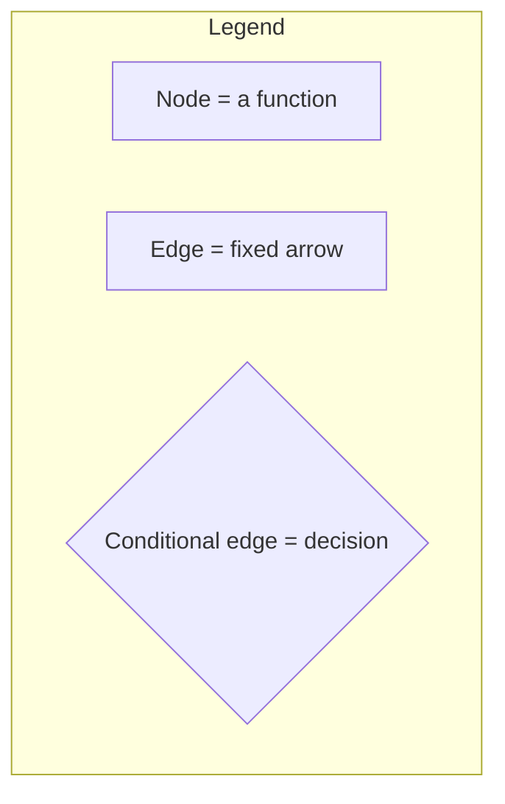

---

## 3.10 Message types

A conversation with an LLM is a **list of messages**. Each message has a *role*:

| Class | Who "said" it | Example |
|---|---|---|
| `SystemMessage` | The developer (instructions for the AI) | "You are a helpful assistant." *(optional, not used in our minimal version)* |
| `HumanMessage` | **You** | "Create hello.txt" |
| `AIMessage` | The **LLM** | "Done!" — *or* a **tool request** |
| `ToolMessage` | The **result of a tool** | "[+] File written successfully: hello.txt" |

When the LLM wants a tool, its `AIMessage` contains a field called **`tool_calls`**, e.g.:

```python
AIMessage(
    content="",
    tool_calls=[{
        "name": "write_file",
        "args": {"file_path": "hello.txt", "content": "Hi"},
        "id": "call_abc123"
    }]
)
```

Our graph simply asks: **"Does the last AI message have `tool_calls`?"** → *Yes* → run tools. *No* → we're done.

---

# 🛠️ PART B — Setup Your Computer

## Step 1 — Create a project folder

```bash
mkdir my-first-agent
cd my-first-agent
```

Final structure we will end up with:

```text
my-first-agent/
├── agent.py            ← our program
├── .env                ← secrets (NEVER upload to GitHub)
├── .env.example        ← a safe template (OK to upload)
├── .gitignore          ← tells Git to ignore secret files
└── requirements.txt    ← list of libraries
```

## Step 2 — Create a virtual environment

A **virtual environment (venv)** is a private box for this project's libraries so they don't mix with other projects.

**macOS / Linux**
```bash
python3 -m venv venv
source venv/bin/activate
```

**Windows (PowerShell)**
```powershell
python -m venv venv
venv\Scripts\Activate.ps1
```

**Windows (CMD)**
```cmd
python -m venv venv
venv\Scripts\activate.bat
```

✅ You'll know it worked when your terminal line starts with `(venv)`.

## Step 3 — Install the libraries

Create a file called **`requirements.txt`**:

```text
langchain-core
langchain-openai
langgraph
python-dotenv
```

Install them:

```bash
pip install -r requirements.txt
```

| Package | What it does |
|---|---|
| `langchain-core` | Core LangChain pieces: messages (`HumanMessage`) and the `@tool` decorator |
| `langchain-openai` | Provides `ChatOpenAI`, which talks to any OpenAI-compatible server (like Ollama) |
| `langgraph` | Lets us build the graph (`StateGraph`, `ToolNode`, …) |
| `python-dotenv` | Reads your `.env` file so secrets stay out of your code |

## Step 4 — Get your Ollama API key

1. Create / log in to your account at **[ollama.com](https://ollama.com)**.
2. Open your account settings and find the **API keys** section.
3. Create a new key and **copy it** (you may not be able to see it again).

## Step 5 — Create the `.env` file

In your project folder create a file named exactly **`.env`** (yes, it starts with a dot and has no name before it):

```env
OLLAMA_API_KEY=paste_your_real_key_here
OLLAMA_MODEL=gemma4:31b
OLLAMA_API_URL=https://ollama.com/v1
```

- `OLLAMA_API_KEY` → your secret key.
- `OLLAMA_MODEL` → the model to use. **It must support tool calling.** Change it to any tool-capable model you like.
- `OLLAMA_API_URL` → Ollama Cloud's OpenAI-compatible address.

> ⚠️ No spaces around `=`, and no quotes needed.

## Step 6 — Protect your secrets with `.gitignore`

Create a file named **`.gitignore`**:

```text
.env
venv/
__pycache__/
```

This tells Git: **"never upload these."** Without this, you might accidentally publish your API key to GitHub, and strangers could use (and bill) your account.

Also create a **`.env.example`** — a *safe* template you *can* upload so others know what to fill in:

```env
OLLAMA_API_KEY=your_api_key
OLLAMA_MODEL=gemma4:31b
OLLAMA_API_URL=https://ollama.com/v1
```

---

# 🧱 PART C — Build the Agent Step by Step

Create a file called **`agent.py`**. We'll write it **one block at a time**, and I'll explain *every line*. (The full file is in [Part D](#-part-d--the-complete-code).)

---

## Block 1 — Imports

```python
import os
from dotenv import load_dotenv
from langchain_core.tools import tool
from langchain_core.messages import HumanMessage
from langchain_openai import ChatOpenAI
from langgraph.graph import StateGraph, MessagesState, START
from langgraph.prebuilt import ToolNode, tools_condition
```

An **import** means *"bring in a tool from a library so I can use it."*

| Line | Meaning |
|---|---|
| `import os` | Python's built-in module for talking to the operating system. We use it to read **environment variables**. |
| `from dotenv import load_dotenv` | Brings in the function that loads the `.env` file. |
| `from langchain_core.tools import tool` | Brings in the `@tool` **decorator** that converts a function into an LLM tool. |
| `from langchain_core.messages import HumanMessage` | A message class representing **what the user said**. |
| `from langchain_openai import ChatOpenAI` | The **chat model connector** (our link to the LLM). |
| `from langgraph.graph import StateGraph, MessagesState, START` | The graph-building pieces: the graph builder, the ready-made state, and the start marker. |
| `from langgraph.prebuilt import ToolNode, tools_condition` | Two ready-made helpers: a node that **runs tools** and a function that **decides** whether tools are needed. |

---

## Block 2 — Load configuration from `.env`

```python
load_dotenv()

API_KEY = os.getenv("OLLAMA_API_KEY")
API_URL = os.getenv("OLLAMA_API_URL", "https://ollama.com/v1")
MODEL = os.getenv("OLLAMA_MODEL")

if not API_KEY or not MODEL:
    raise ValueError("Check OLLAMA_API_KEY and OLLAMA_MODEL in .env")
```

**Line by line:**

- `load_dotenv()` → Reads your `.env` file and puts each `KEY=value` line into the program's **environment variables**.
- `os.getenv("OLLAMA_API_KEY")` → Looks up an environment variable by name. If it doesn't exist, it returns `None`.
- `os.getenv("OLLAMA_API_URL", "https://ollama.com/v1")` → Same, but the **second value is a default**: if `OLLAMA_API_URL` is missing, use `https://ollama.com/v1`.
- `API_KEY`, `API_URL`, `MODEL` are just **variables**. (Written in CAPITAL LETTERS by convention to say "this is a setting that won't change".)
- `if not API_KEY or not MODEL:` → "If the key is missing **or** the model is missing…"
- `raise ValueError("...")` → …**stop the program immediately** with a clear error message. This is called **failing fast**: better to get a clear message now than a confusing crash later.

---

## Block 3 — Create the LLM object

```python
llm = ChatOpenAI(
    base_url=API_URL,
    api_key=API_KEY,
    model=MODEL,
    temperature=0
)
```

This creates a Python object called `llm` that **represents the connection to the model**.

| Argument | Meaning |
|---|---|
| `base_url=API_URL` | **Where** to send requests (Ollama's server instead of OpenAI's). |
| `api_key=API_KEY` | **Who you are** (your secret key). |
| `model=MODEL` | **Which** model to use. |
| `temperature=0` | Controls **randomness**. `0` = focused and predictable (best for agents that must follow instructions and call tools correctly). Higher values (like `1`) = more creative but less reliable. |

> After this, calling `llm.invoke("Hi")` would already send a message to the cloud model and give back an answer. But this `llm` doesn't know about our tools yet.

---

## Block 4 — Make the tools

### The `read_file` tool

```python
@tool
def read_file(file_path: str) -> str:
    """Read a file at the given path and return its content."""
    try:
        with open(file_path, "r", encoding="utf-8") as f:
            return f.read()
    except OSError as error:
        return f"Error reading file: {error}"
```

Let's decode every piece:

**`@tool`** — This is a **decorator**: a line placed above a function that *upgrades* it. Here it converts a plain Python function into a **LangChain tool**, automatically generating a description the LLM can understand.

**`def read_file(file_path: str) -> str:`**
- `def` → define a function.
- `read_file` → the function's **name**. ⚠️ *The LLM sees this name*, so make it clear!
- `file_path: str` → one input called `file_path`, which is text (a **type hint**). The LLM reads this type hint to know *what kind of value to send*.
- `-> str` → the function returns text.

**`"""Read a file at the given path…"""`** — The **docstring**. 🚨 **This is critical:** LangChain gives this sentence to the LLM as the **tool's description**. The LLM decides *whether and when to use the tool* based on it. A tool with a bad docstring = an LLM that doesn't know when to use it.

**`try: … except OSError as error:`** — **Error handling.** Reading files can fail (file doesn't exist, no permission…).
- `try:` → "attempt this code."
- `except OSError as error:` → "if a file/OS-related error happens, catch it and store it in `error`."
- Instead of crashing, we **return the error as text**. The LLM reads it and can react (e.g. tell the user "that file doesn't exist"). 

**`with open(file_path, "r", encoding="utf-8") as f:`**
- `open(...)` → opens a file.
- `"r"` → **r**ead mode.
- `encoding="utf-8"` → the text format that handles all languages & emojis correctly.
- `with … as f:` → opens the file as `f` and **automatically closes it** afterwards (even if there's an error). Always prefer `with`.

**`return f.read()`** → reads the *entire* file as one string and returns it.

### The `write_file` tool

```python
@tool
def write_file(file_path: str, content: str) -> str:
    """Write content to a file at the given path. Creates the file if it does not exist."""
    try:
        with open(file_path, "w", encoding="utf-8") as f:
            f.write(content)
        return f"[+] File written successfully: {file_path}"
    except OSError as error:
        return f"Error writing file: {error}"
```

Almost identical, with differences:

- It takes **two inputs**: `file_path` (where) and `content` (what to save).
- `"w"` → **w**rite mode. ⚠️ This **creates** the file if missing, and **erases and replaces** it if it exists!
- `f.write(content)` → saves the text.
- `f"[+] File written successfully: {file_path}"` → an **f-string**: the `{file_path}` is replaced by the real value. This message becomes the `ToolMessage` the LLM sees, confirming success.

### Put the tools in a list and give them to the LLM

```python
tools = [read_file, write_file]
llm_with_tools = llm.bind_tools(tools)
```

- `tools = [...]` → a normal Python list of our two tools.
- `llm.bind_tools(tools)` → returns a **new version of the LLM** that, on every request, also sends the **names, descriptions and inputs of the tools** to the server. Now the model *knows it's allowed to ask for them*.

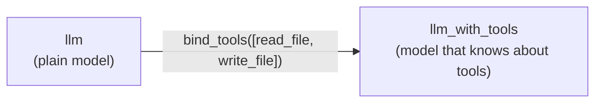

---

## Block 5 — The first node: `ask`

```python
def ask(state: MessagesState):
    response = llm_with_tools.invoke(state["messages"])
    return {"messages": [response]}
```

This is a **node**: a function that receives the **state** and returns an **update**.

- `state: MessagesState` → the function receives the shared notebook (type hint).
- `state["messages"]` → pulls out the **full list of messages** so far (remember: the LLM has no memory, so we send *everything* every time).
- `llm_with_tools.invoke(...)` → sends the messages to the model and **waits for its reply**. `invoke` just means "run it once now."
- `response` → an `AIMessage`. It either contains a normal answer **or** `tool_calls`.
- `return {"messages": [response]}` → "add this new message to the notebook." Because `MessagesState` **appends**, the history grows by one message.

---

## Block 6 — The second node: `ToolNode`

```python
tool_node = ToolNode(tools)
```

`ToolNode` is a **ready-made node** from LangGraph. When it runs, it:

1. Looks at the **last message** in the state (the AI's request).
2. Finds the `tool_calls` inside it.
3. **Runs the matching Python function(s)** with the arguments the LLM provided.
4. Wraps each result in a **`ToolMessage`** and appends it to the state.

You don't have to write any of that logic. 🎉

---

## Block 7 — Build the graph

```python
builder = StateGraph(MessagesState)

builder.add_node("ask", ask)
builder.add_node("tools", tool_node)

builder.add_edge(START, "ask")
builder.add_conditional_edges("ask", tools_condition)
builder.add_edge("tools", "ask")

agent = builder.compile()
```

Line by line:

| Code | Plain-English meaning |
|---|---|
| `StateGraph(MessagesState)` | "Start a new graph whose shared notebook is a list of messages." |
| `add_node("ask", ask)` | "Create a box named **ask** that runs my `ask` function." |
| `add_node("tools", tool_node)` | "Create a box named **tools** that runs the `ToolNode`." |
| `add_edge(START, "ask")` | "When the graph begins, go to **ask**." |
| `add_conditional_edges("ask", tools_condition)` | "After **ask**, call `tools_condition` to decide where to go next." |
| `add_edge("tools", "ask")` | "After **tools**, **always go back to ask**." ← *this creates the loop!* |
| `builder.compile()` | "Finish the blueprint and build the runnable agent." |

### What is `tools_condition`?

A ready-made decision function. It looks at the **last message**:

- Has `tool_calls`? → returns `"tools"` → go to the **tools** node.
- No `tool_calls`? → returns `END` → the graph **stops**.

That's why we never wrote an `END` ourselves — `tools_condition` handles it.

### The finished graph

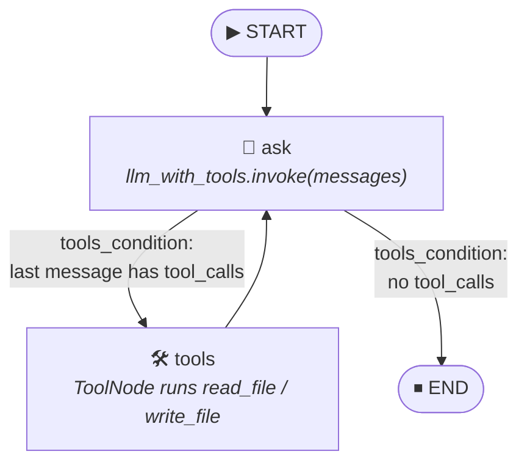

> `builder` = the **blueprint**. `agent` = the **finished machine** built from that blueprint.

---

## Block 8 — The chat loop

```python
if __name__ == "__main__":
    while True:
        prompt = input("> ").strip()

        if prompt.lower() == "exit":
            break
        if not prompt:
            continue

        result = agent.invoke({"messages": [HumanMessage(content=prompt)]})

        print("\nAI:", result["messages"][-1].content, "\n")
```

- `if __name__ == "__main__":` → "Only run this part if the file is run **directly** (`python agent.py`), not if another file imports it." A standard Python pattern.
- `while True:` → an **infinite loop**: keep asking for input again and again.
- `input("> ")` → shows a `>` prompt and waits for you to type; returns what you typed. `.strip()` removes extra spaces around it.
- `prompt.lower() == "exit"` → if you typed `exit` (any capitalization), `break` **leaves the loop** and the program ends.
- `if not prompt: continue` → if you just pressed Enter (empty text), skip and ask again.
- `HumanMessage(content=prompt)` → wraps your text in a "human" message.
- `agent.invoke({"messages": [...]})` → **runs the whole graph** from `START` with this starting state. It returns the **final state** when the graph reaches `END`.
- `result["messages"][-1]` → the **last message** in the final state (`[-1]` = last item of a list). That is the AI's final answer.
- `.content` → the text of that message.

---

# 📦 PART D — The Complete Code

Copy this entire block into **`agent.py`**:

```python
import os
from dotenv import load_dotenv
from langchain_core.tools import tool
from langchain_core.messages import HumanMessage
from langchain_openai import ChatOpenAI
from langgraph.graph import StateGraph, MessagesState, START
from langgraph.prebuilt import ToolNode, tools_condition

# ─────────────────────────────────────────────
# 1. CONFIGURATION  (read secrets from .env)
# ─────────────────────────────────────────────
load_dotenv()

API_KEY = os.getenv("OLLAMA_API_KEY")
API_URL = os.getenv("OLLAMA_API_URL", "https://ollama.com/v1")
MODEL = os.getenv("OLLAMA_MODEL")

if not API_KEY or not MODEL:
    raise ValueError("Check OLLAMA_API_KEY and OLLAMA_MODEL in .env")

# ─────────────────────────────────────────────
# 2. THE LLM  (the brain)
# ─────────────────────────────────────────────
llm = ChatOpenAI(
    base_url=API_URL,
    api_key=API_KEY,
    model=MODEL,
    temperature=0,  # 0 = predictable, best for tool calling
)

# ─────────────────────────────────────────────
# 3. THE TOOLS  (the hands)
#    The docstring is what the LLM reads to understand each tool!
# ─────────────────────────────────────────────
@tool
def read_file(file_path: str) -> str:
    """Read a file at the given path and return its content."""
    try:
        with open(file_path, "r", encoding="utf-8") as f:
            return f.read()
    except OSError as error:
        return f"Error reading file: {error}"


@tool
def write_file(file_path: str, content: str) -> str:
    """Write content to a file at the given path. Creates the file if it does not exist."""
    try:
        with open(file_path, "w", encoding="utf-8") as f:
            f.write(content)
        return f"[+] File written successfully: {file_path}"
    except OSError as error:
        return f"Error writing file: {error}"


tools = [read_file, write_file]
llm_with_tools = llm.bind_tools(tools)  # tell the LLM which tools exist

# ─────────────────────────────────────────────
# 4. THE NODES  (the boxes in our graph)
# ─────────────────────────────────────────────
def ask(state: MessagesState):
    """Send the whole conversation to the LLM and store its reply."""
    response = llm_with_tools.invoke(state["messages"])
    return {"messages": [response]}


tool_node = ToolNode(tools)  # runs whichever tool the LLM asked for

# ─────────────────────────────────────────────
# 5. THE GRAPH  (the blueprint)
#
#   START → ask ──(wants a tool?)──► tools
#            ▲                          │
#            └──────────────────────────┘
#            └──(no tool needed)──► END
# ─────────────────────────────────────────────
builder = StateGraph(MessagesState)

builder.add_node("ask", ask)
builder.add_node("tools", tool_node)

builder.add_edge(START, "ask")
builder.add_conditional_edges("ask", tools_condition)  # → "tools" or END
builder.add_edge("tools", "ask")                       # loop back

agent = builder.compile()

# ─────────────────────────────────────────────
# 6. THE CHAT LOOP
# ─────────────────────────────────────────────
if __name__ == "__main__":
    print("Agent ready! Type 'exit' to quit.\n")

    while True:
        prompt = input("> ").strip()

        if prompt.lower() == "exit":
            break
        if not prompt:
            continue

        result = agent.invoke({"messages": [HumanMessage(content=prompt)]})

        print("\nAI:", result["messages"][-1].content, "\n")
```

---

# ▶️ PART E — Run It!

Make sure your virtual environment is active (you see `(venv)`), then:

```bash
python agent.py
```

You should see:

```text
Agent ready! Type 'exit' to quit.

>
```

### Try these prompts, in order

**1. Make a file**
```text
> create a file called hello.txt that says "Hello from my first agent!"

AI: I've created hello.txt with the text "Hello from my first agent!".
```

**2. Read it back**
```text
> read hello.txt and tell me what is inside

AI: The file hello.txt contains: Hello from my first agent!
```

**3. A multi-step task (this shows the loop!)**
```text
> read hello.txt, then create shout.txt with the same text in capital letters

AI: Done! shout.txt now contains: HELLO FROM MY FIRST AGENT!
```

**4. A normal chat (no tool needed)**
```text
> what is the capital of Japan?

AI: The capital of Japan is Tokyo.
```

**5. A failure the agent can handle**
```text
> read the file nothing.txt

AI: I couldn't find a file named nothing.txt...
```

**6. Quit**
```text
> exit
```

> 📌 Exact wording will differ each run — LLMs phrase things differently. What matters is that the files appear in your folder. Check your project directory: `hello.txt` and `shout.txt` should be there! 🎉

---

# 🔍 PART F — How One Question Flows Through the Agent

Let's follow this prompt closely:

> `read hello.txt, then create shout.txt with the same text in capital letters`

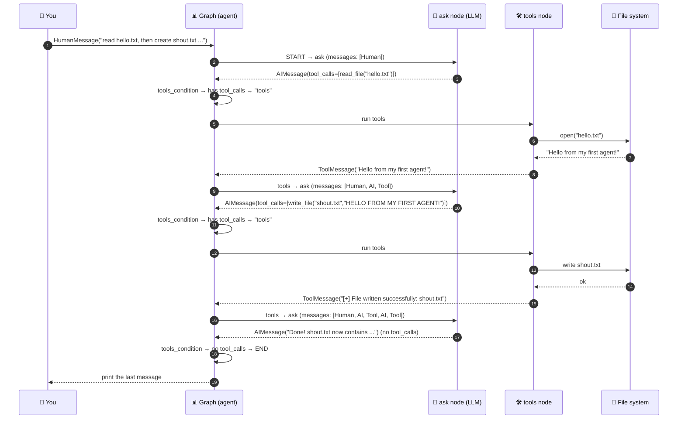

### What the state (notebook) looks like at the end

```text
messages = [
  1. HumanMessage   : "read hello.txt, then create shout.txt ..."
  2. AIMessage      : tool_calls → read_file(file_path="hello.txt")
  3. ToolMessage    : "Hello from my first agent!"
  4. AIMessage      : tool_calls → write_file(file_path="shout.txt", content="HELLO FROM MY FIRST AGENT!")
  5. ToolMessage    : "[+] File written successfully: shout.txt"
  6. AIMessage      : "Done! shout.txt now contains ..."      ← result["messages"][-1]
]
```

The agent passed through `ask` **three times** and `tools` **twice**. **You never wrote code for "do step 1 then step 2".** The LLM figured out the order by itself. That is what makes it an *agent*. ✨

---

# 🩺 Troubleshooting

| Problem | Likely cause | Fix |
|---|---|---|
| `ValueError: Check OLLAMA_API_KEY and OLLAMA_MODEL in .env` | `.env` missing, misnamed, or in the wrong folder | The file must be named exactly `.env` and sit **next to `agent.py`**. Check there are no typos in the variable names. |
| `ModuleNotFoundError: No module named 'dotenv'` | Library not installed or venv not active | Activate the venv, then `pip install -r requirements.txt`. (The package is named `python-dotenv`, but you import `dotenv`.) |
| `ModuleNotFoundError: No module named 'langgraph'` (or `langchain_openai`) | Same as above | Activate venv + reinstall requirements. |
| `401 Unauthorized` / `Invalid API key` | Wrong or expired key | Re-copy the key into `.env`. Don't add quotes or extra spaces. |
| `404` / `model not found` | Wrong model name | Check the exact model name on the Ollama website, including the tag after the `:`. |
| Error saying the model **does not support tools** | The chosen model can't do tool calling | Switch `OLLAMA_MODEL` to a model with the **tools** tag. |
| The AI *says* it created a file but nothing exists | Model ignored the tools (weak model) | Try a stronger model, or be more explicit: *"use the write_file tool to…"*. |
| `GraphRecursionError` | The agent looped too many times (default limit ≈ 25 steps) | Simplify your request; make sure tool docstrings are clear. |
| Connection / timeout errors | Internet or firewall issue | Check your connection and that `OLLAMA_API_URL` is `https://ollama.com/v1`. |
| `.env` changes not applied | Program was still running | Stop it (`Ctrl+C`) and run again. |

---

# ⚠️ Safety Warning

Your agent can **read any file** and **overwrite any file** your user account can access (not just in this folder!). `"w"` mode **erases** existing content.

- 🚫 Don't run it in an important folder (Documents, Desktop, a real project).
- ✅ Run it in a **throwaway practice folder**, like this tutorial's folder.
- 🔑 **Never commit `.env`.** If you ever accidentally upload your API key, **delete it and create a new one immediately.**
- 🧪 Challenge #1 below shows how to lock the agent into a single safe folder.

---

# 📖 Glossary (Cheat Sheet)

| Term | One-line definition |
|---|---|
| **LLM** | A model that predicts text; the "brain". |
| **Ollama** | A service/tool for running LLMs (locally or in the cloud). |
| **API** | Rules for one program to talk to another over the internet. |
| **API key** | Your secret password for an API. Never share it. |
| **Base URL** | The server address your requests go to. |
| **`.env` file** | A text file holding secrets/settings, kept out of your code. |
| **Environment variable** | A named setting available to a running program. |
| **Tool** | A Python function the LLM may ask your program to run. |
| **Tool calling** | The LLM's ability to output a structured request to run a tool. |
| **Docstring** | The `"""text"""` under a function; the LLM reads it as the tool's description. |
| **Decorator (`@tool`)** | A line above a function that upgrades/wraps it. |
| **Agent** | LLM + tools + a loop (Think → Act → Observe). |
| **LangChain** | A toolbox of building blocks for LLM apps. |
| **LangGraph** | A library to wire those blocks into a graph with loops and decisions. |
| **State** | The shared notebook passed through the graph. |
| **`MessagesState`** | Ready-made state: a list of messages that **appends** new ones. |
| **Node** | One step (a function) in the graph. |
| **Edge** | A fixed arrow between nodes. |
| **Conditional edge** | An arrow chosen by a decision function. |
| **`START` / `END`** | Special markers for where the graph begins and stops. |
| **`ToolNode`** | Ready-made node that executes the tools the LLM requested. |
| **`tools_condition`** | Ready-made decision: tool calls present → `tools`, else → `END`. |
| **`bind_tools`** | Tells the LLM which tools exist. |
| **`invoke`** | "Run this once now and give me the result." |
| **`temperature`** | Randomness dial: `0` = predictable, higher = creative. |
| **`HumanMessage`** | A message from the user. |
| **`AIMessage`** | A message from the LLM (may contain `tool_calls`). |
| **`ToolMessage`** | The result of a tool, fed back to the LLM. |
| **`compile()`** | Turns the graph blueprint into a runnable agent. |

---

## 🧩 The Whole Thing in One Picture

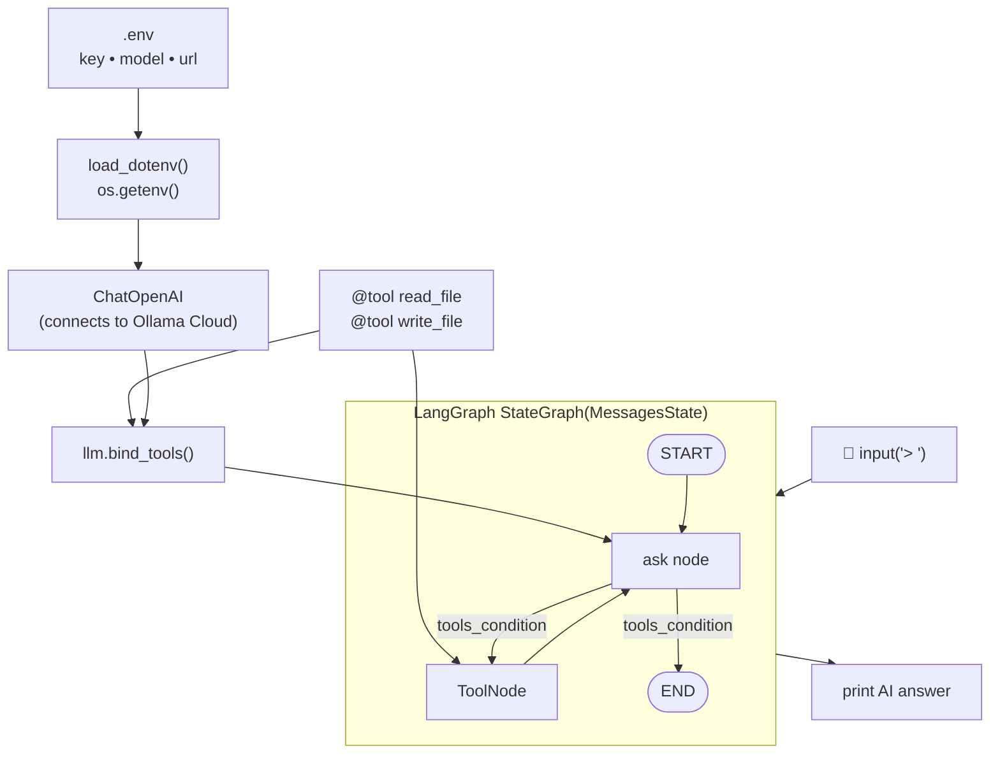


## 🎉 Congratulations!

You just built a working **agentic AI system** and understand every part of it:

- an **LLM** as the brain 🧠
- **tools** as the hands 🛠️
- a **graph** as the nervous system that connects them 🕸️
- a **loop** that lets it think, act and observe until the job is done 🔁

Every advanced agent you will ever see — coding assistants, research agents, customer-support bots — is a bigger version of this same pattern. Keep building! 🚀

---

<p align="center">
  If this tutorial helped you, consider giving the repo a ⭐
</p>
